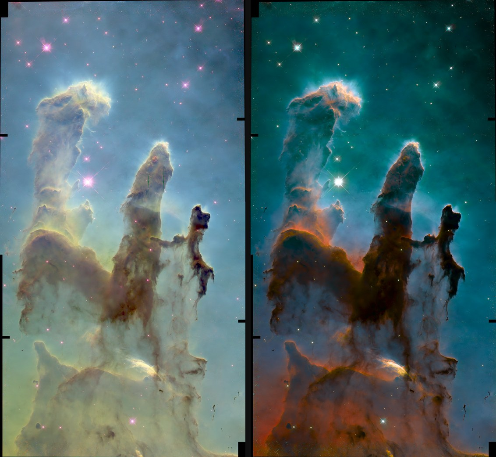
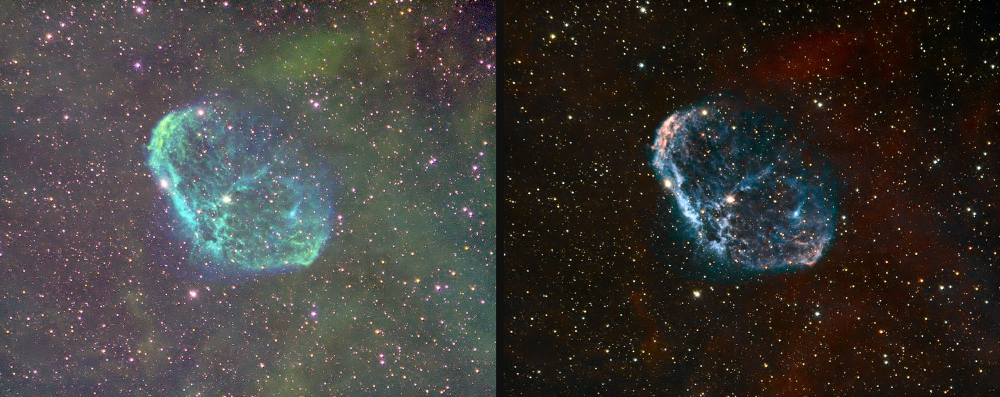
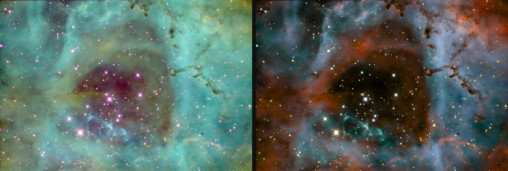

# astro-sho-modified-palette

A narrowband colour palette for astronomy: an SHO style image with **white stars and no green**,
without star removal, green removal or hand tuning.



*M16, Hubble data. Left: plain SHO. Right: this palette.*

## Use it

Give it three stacked, aligned, linear mono images, in the order Ha, OIII, SII:

```
python3 sho_palette.py Ha.fits OIII.fits SII.fits
```

It writes `sho-palette.tif` beside the Ha image, a 16 bit colour TIFF that is already stretched.
FITS and TIFF are both accepted, and most stackers can save these (Siril, for example).

### Install

You need Python 3 and three libraries.

**Windows or Mac:**

```
pip install -r requirements.txt
```

**Debian or Raspberry Pi OS:**

```
sudo apt install python3-numpy python3-astropy python3-tifffile
```

### Try it

Three small images are included, cropped from the Hubble M16 data:

```
python3 sho_palette.py samples/m16-Ha.fits.gz samples/m16-OIII.fits.gz samples/m16-SII.fits.gz
```

### Options

You shouldn't need these to begin with.

| Option | Default | What it does |
|---|---|---|
| `-o name.tif` | `sho-palette.tif` beside the Ha image | Output file |
| `--balance` | 8 | Colour balance: higher is more gold, negative is more cyan |
| `--threshold` | 60 | Higher means less colour in faint, noisy areas |
| `--brightness` | 1 | Multiplies the automatic brightness, for example 1.5 or 0.7 |

## Your images

- **They must be linear**, as they come from the stacker. Don't stretch them first. The tool warns
  if they look stretched, but it can't always tell.
- **They must be aligned** with each other and the same size.
- **Reduce noise first if you want to.** This tool doesn't reduce noise, though it does keep noise
  from turning into colour.
- **Exact zeros count as no data**, which handles the empty borders that alignment leaves. They come
  out black.

## How it works

The usual SHO mapping puts Ha in green. Ha is usually the strongest filter, so the image turns green,
and removing the green afterwards leaves the stars magenta. This palette doesn't assign filters to
channels at all. It works from the **ratios** between filters, and keeps brightness and colour
separate, much as a TV signal keeps Y apart from U and V.

1. **Star balance.** Each filter is scaled so a typical star has Ha = OIII = SII, measured from up to
   300 bright stars. Gas still has Ha much stronger than the others, so the ratios now tell stars
   from gas.
2. **Gold to cyan.** The ratio of OIII to SII gives one axis:

   `h = tanh(1.5 ln((O + k) / (S + k)))`

   A ratio of 1 gives no colour, so stars stay white.
3. **Noise.** `k` comes from the local noise. Added to both sides of a ratio, it pulls the ratio to 1
   wherever the signal is below the noise, so empty sky stays neutral.
4. **The twist.** The ratio of Ha to the other two turns that axis:

   `q = ln((Ha + k) / ((O + S)/2 + k))`

   Low Ha leans towards green and high Ha towards red and blue. The amount of turn comes from a
   histogram of `q`, one for each side of the axis, so the gas of any subject uses the whole range.
   `q` also pushes across the axis, towards red or blue.
5. **Stars.** Anything standing well above its surroundings loses its colour.
6. **Brightness** comes from the sum of the three filters, at full resolution. Colour comes from 7x7
   means, as it needs less detail.
7. **Display.** The colour is built in OKLab. If a colour can't be shown, it loses just enough chroma
   to fit, so no channel clips and hues hold.

`sho_palette.py` is one short file, with each of these steps commented.

## More examples



*NGC 6888, Crescent Nebula, 300 mm amateur telescope and ASI1600MM Pro.*



*Rosette Nebula, same equipment.*

In every comparison, the left image is plain SHO with no further processing: SII in red, Ha in green,
OIII in blue, with each filter stretched automatically. Careful hand processing can improve on it a
lot. It's there to show the starting point.

## Limits

- **Colours depend on the whole frame.** The star balance and the twist are measured from the image,
  so a crop can come out with somewhat different colours from the full frame. Process the full frame
  and crop afterwards.
- **Fields with very reddened stars.** M16 is one. The star balance is limited to a factor of 4, so
  its stars can keep some colour.
- **Very few stars.** With fewer than 8 usable stars there is no star balance, and the tool says so.
- **It isn't scientific colour.** Like SHO, it's a way of showing the differences between filters.
- **Speed.** About 1 minute for a 33 megapixel image on a Raspberry Pi 5.

## Credits

M16 data: NASA, ESA and STScI, Hubble Space Telescope programme 13926. NGC 6888 and Rosette images:
the author. All the images were stacked and noise reduced before this palette was applied.

Licence: MIT, see [LICENSE](LICENSE).
